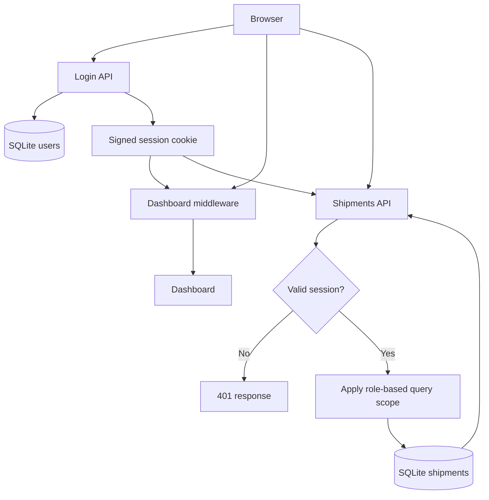

# Tradeix — Shipment Visibility Platform

**Next.js · TypeScript · SQLite · Session Authentication · Docker**

Tradeix is a **prototype** for exploring shipment visibility and customer-specific logistics dashboards. It currently uses seeded records, not live carrier or port feeds.

## What you can inspect

| Area | Implementation | Key files |
| --- | --- | --- |
| Authentication | Login verifies bcrypt password hashes and issues signed session cookies | `app/api/auth/login/route.ts`, `lib/session.ts` |
| Protected dashboard | Middleware redirects unauthenticated dashboard visitors to login | `middleware.ts` |
| Shipment API | Returns 401 without a session; applies customer ID filtering for the `customer` role | `app/api/shipments/route.ts` |
| Persistence | Local SQLite database with seed and migration scripts | `lib/db.ts`, `scripts/` |
| Delivery workflow | GitHub Actions workflow and Docker build configuration | `.github/workflows/ci-cd.yml`, `Dockerfile` |

## Request flow



**Security boundary:** The shipment endpoint applies `customer_id = ?` for users with the `customer` role. Other roles currently use broader access; production authorization rules require further review. A separate open pull request addresses production session-secret configuration.

## Run locally

Requires Node.js 20 and npm.

```bash
npm ci
npm run db:migrate
npm run db:seed
npm run dev
```

Visit `http://localhost:3000`. Seeded demo credentials (for local development only): `demo@tradeix.com` / `demo1234`.

## Verify

```bash
npm test
npm run build
```

The GitHub Actions workflow also includes linting and a container image scan. **A configured workflow is not evidence that every job currently passes.** Inspect the [Actions tab](https://github.com/akashphilipvarghese-code/tradeix-platform/actions) for actual run results.

## Docker

```bash
docker build -t tradeix-interface .
docker run -p 3000:3000 --env-file .env tradeix-interface
```

Configure a unique `SESSION_SECRET` for any nonlocal deployment. See the [open session-hardening PR](https://github.com/akashphilipvarghese-code/tradeix-platform/pull/2) for production fail-closed enforcement; until merged, the default branch retains a development fallback.

## Not production-ready

- Shipment records are seeded; there is no live AIS, carrier, or port integration.
- The database is local SQLite, not a production database deployment.
- CI includes a deployment **placeholder**, not a working production rollout.
- Production secrets, role permissions, operational monitoring, rollback, and legal pages need review.
- There is no verified public deployment or independently reproduced performance benchmark.

## Next engineering priorities

1. Pass CI and merge reviewed security and workflow fixes.
2. Add integration tests for customer isolation, login failures, and role permissions.
3. Document database migration and deployment strategy before introducing production infrastructure.

This repository documents implemented behavior separately from planned capabilities.
